# Alicia en el País de las Maravillas - Actividad Práctica

**Asignatura:** Programación Web I  
**Estudiante:** EDILSON BEIMAR SUCA ROMAN  

---

## 🔗 Enlaces Obligatorios de Entrega

* 🌐 **Página Web Publicada:** `[PEGA_AQUÍ_TU_ENLACE_DE_GITHUB_PAGES]`
* 📁 **Repositorio Git:** `[PEGA_AQUÍ_TU_ENLACE_DEL_REPOSITO_GITHUB]`
* 🎥 **Video Explicativo (≤ 3 min):** `[PEGA_AQUÍ_TU_ENLACE_DE_DRIVE_O_YOUTUBE]`

---

## 📜 Descripción del Proyecto

Este proyecto consiste en una aplicación web interactiva inspirada en *Alicia en el País de las Maravillas*, desarrollada con HTML5, CSS3 y JavaScript nativo (vanilla JS). La plataforma permite resolver tres problemas lógicos presentados en una interfaz navegable por pestañas sin recargar la página.

### Ejercicios Incluidos:
1. **La Poción Mágica de Alicia:** Control de tamaño mediante estructuras condicionales (`if / else`).
2. **La Merienda del Sombrerero Loco:** Cálculo de compras y descuentos usando selección múltiple (`switch`).
3. **El Desafío de la Reina de Corazones:** Clasificación y suma de números pares e impares con bucles (`for`).

---

## 🛠️ Explicación Técnica y Conceptos de JavaScript

### 1. Variables y Ámbito (`let` vs `const` vs `var`)
* **`var` / `let`:** Se utilizan para declarar variables cuyos valores cambian durante la ejecución (ej. totales, conteos, nueva altura de Alicia).
* **`const`:** Se emplea para definir valores fijos o constantes que no deben mutar durante el programa (ej. la altura de la puerta fija de 30 cm o los precios unitarios).

### 2. Estructuras de Control
* **`if / else if / else`:** Evalúan condiciones lógicas secuenciales. Se utilizan para validar si los datos de entrada son correctos y si Alicia logra atravesar la puerta según su nueva altura.
* **`switch`:** Estructura de selección múltiple empleada en el Ejercicio 2 para asignar el precio unitario exacto y el nombre del producto según la opción seleccionada en la lista desplegable.
* **`for`:** Bucle de iteración utilizado en el Ejercicio 3 para recorrer secuencialmente los números desde 1 hasta $N$ (cantidad de cartas) e ir acumulando conteos y sumas.

### 3. Funciones Nativas del DOM y Eventos
* **`document.getElementById(id)`:** Selecciona un elemento del HTML mediante su identificador único para capturar su valor o modificar su contenido.
* **`.value`:** Obtiene o asigna el valor albergado en un campo de entrada (`<input>` o `<select>`).
* **`.textContent`:** Permite escribir o actualizar texto de forma segura dentro de un elemento HTML sin interpretar etiquetas externas.
* **`addEventListener("submit", callback)`:** Escucha el evento de envío del formulario para desencadenar la función de procesamiento sin necesidad de usar atributos HTML como `onclick`.
* **`event.preventDefault()`:** Detiene la acción por defecto del formulario (que reanudaría/recargaría la página), logrando la actualización dinámica del DOM.

---

## 🧪 Tabla de Casos de Prueba (5 por Ejercicio)

### Ejercicio 1: La Poción Mágica
| # | Entrada (Altura, Poción) | Resultado Esperado | Resultado Obtenido | Estado |
|---|---------------------------|--------------------|--------------------|--------|
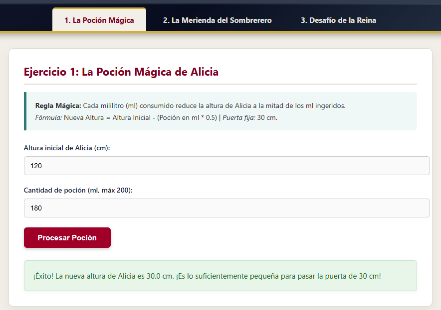
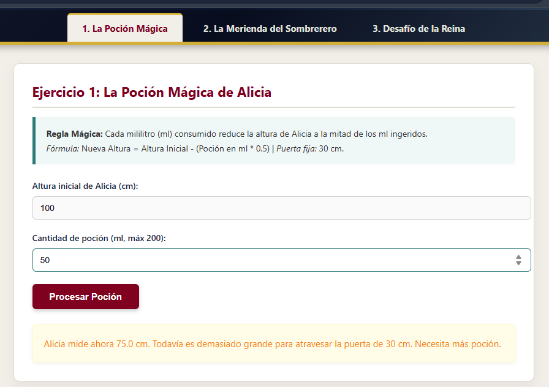
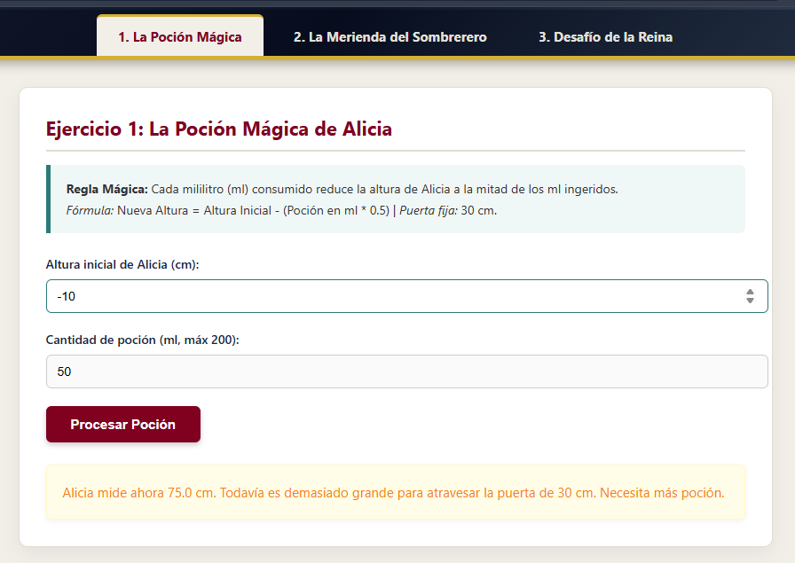
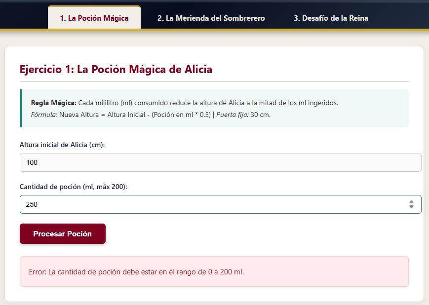
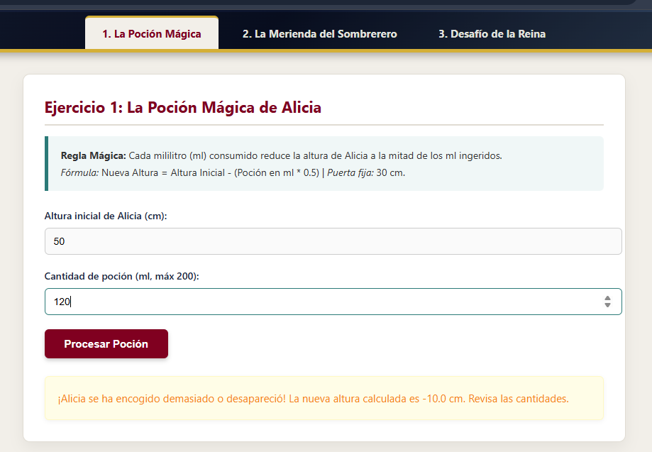

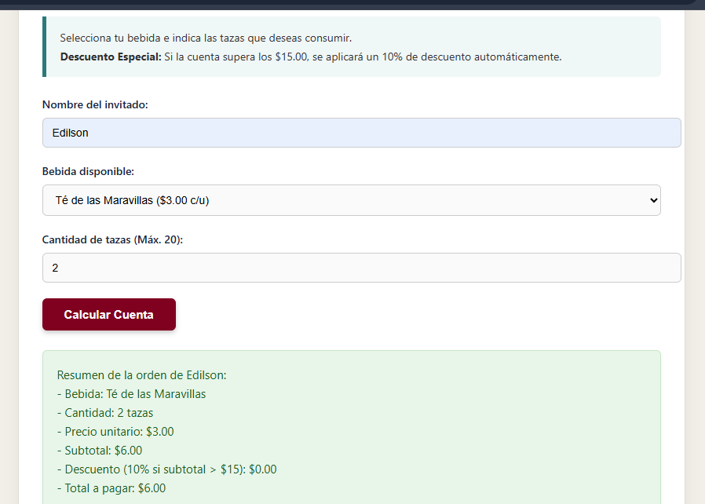
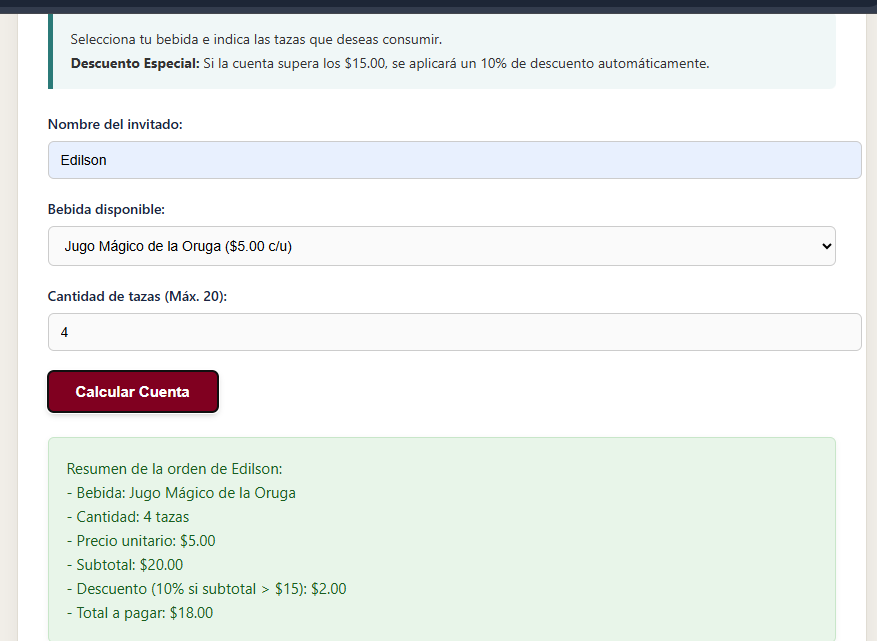
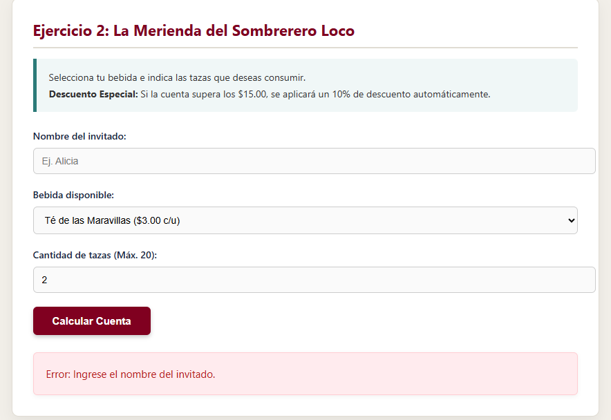
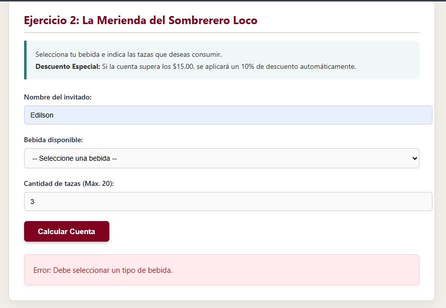
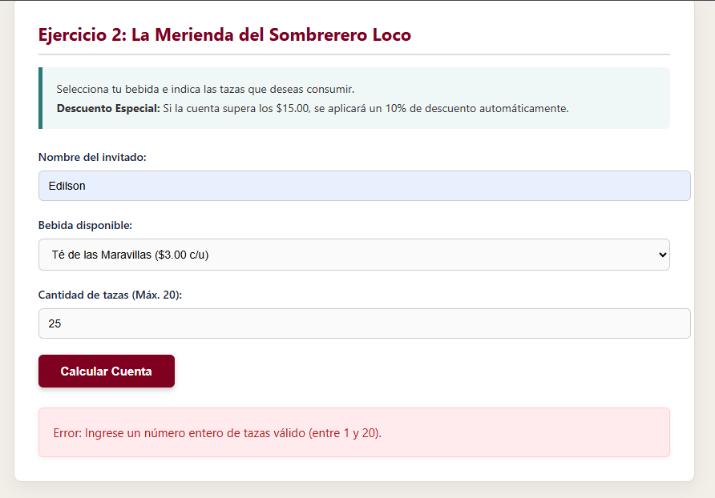

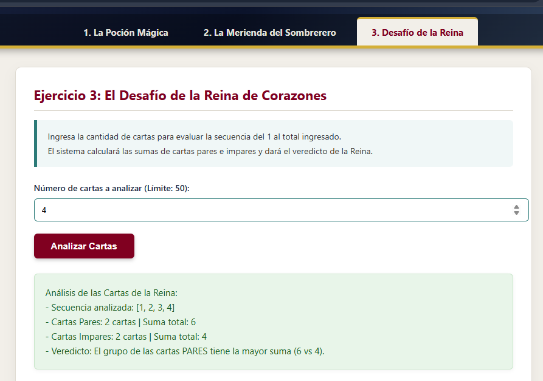
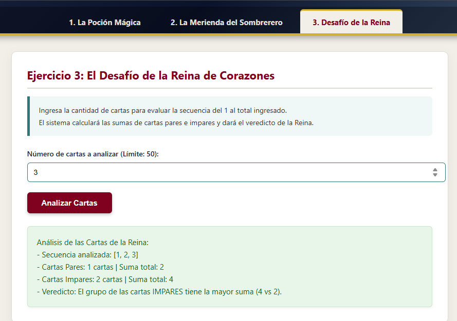
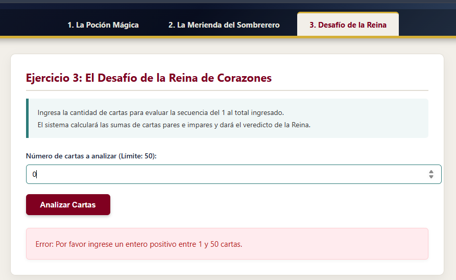
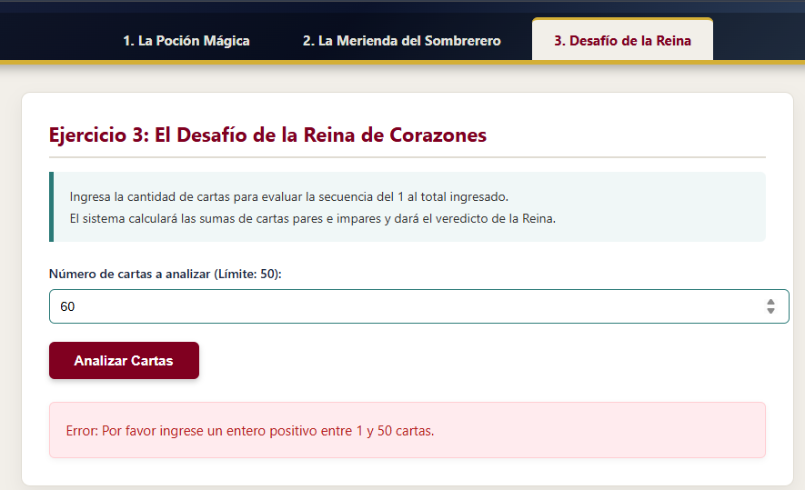
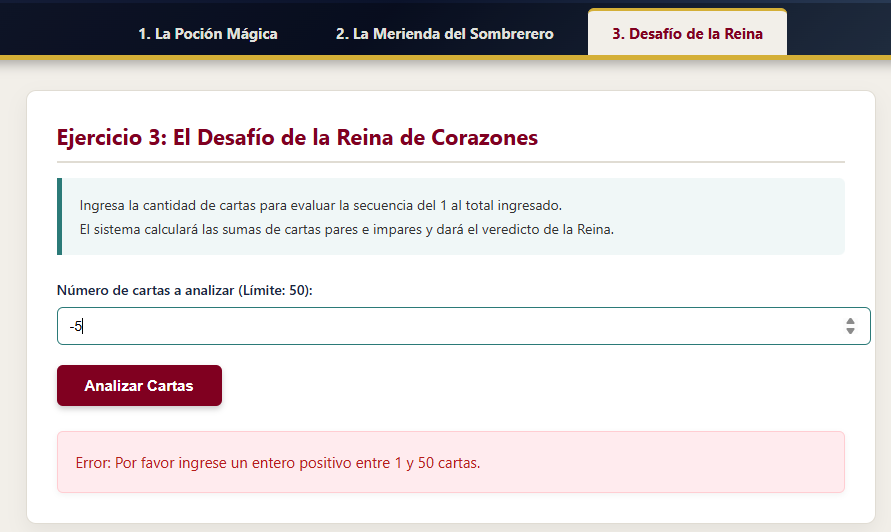

### Ejercicio 2: La Merienda del Sombrerero Loco
| # | Entrada (Nombre, Bebida, Tazas) | Resultado Esperado | Resultado Obtenido | Estado |
|---|----------------------------------|--------------------|--------------------|--------|
| 1 | Nombre: Alicia, Té, Tazas: 2    | Total: $6.00 (Sin descuento) | Subtotal: $6.00, Descuento: $0.00, Total: $6.00 | Correcto |
| 2 | Nombre: Sombrerero, Jugo, Tazas: 4 | Subtotal: $20.00, Desc (10%): $2.00, Total: $18.00 | Subtotal: $20.00, Descuento: $2.00, Total: $18.00 | Correcto |
| 3 | Nombre: "", Té, Tazas: 2        | Error: Ingrese el nombre del invitado. | Error: Ingrese el nombre del invitado. | Validado |
| 4 | Nombre: Lirón, Bebida: "", Tazas: 3 | Error: Debe seleccionar una bebida. | Error: Debe seleccionar un tipo de bebida. | Validado |
| 5 | Nombre: Alicia, Café, Tazas: 25 | Error: Tazas debe ser entre 1 y 20. | Error: Ingrese un número entero de tazas válido... | Validado |

### Ejercicio 3: El Desafío de la Reina de Corazones
| # | Entrada (N° Cartas) | Resultado Esperado | Resultado Obtenido | Estado |
|---|---------------------|--------------------|--------------------|--------|
| 1 | Cartas: 4 | Pares: 2 (Suma: 6), Impares: 2 (Suma: 4). Gana Pares. | Pares: 2 (Suma: 6) \| Impares: 2 (Suma: 4). Veredicto: Pares. | Correcto |
| 2 | Cartas: 3 | Pares: 1 (Suma: 2), Impares: 2 (Suma: 4). Gana Impares. | Pares: 1 (Suma: 2) \| Impares: 2 (Suma: 4). Veredicto: Impares. | Correcto |
| 3 | Cartas: 0 | Error: Ingrese valor entre 1 y 50. | Error: Por favor ingrese un entero positivo entre 1 y 50... | Validado |
| 4 | Cartas: 60 | Error: Excede límite máximo (50). | Error: Por favor ingrese un entero positivo entre 1 y 50... | Validado |
| 5 | Cartas: -5 | Error: Número no válido. | Error: Por favor ingrese un entero positivo entre 1 y 50... | Validado |

---

## 🚨 Errores Frecuentes Identificados y Soluciones

1. **Recarga de la página al enviar el formulario:**
   * *Causa:* Comportamiento predeterminado del evento `submit`.
   * *Solución:* Utilizar `event.preventDefault()` al inicio de cada listener.
2. **Concatenación de texto en lugar de suma matemática:**
   * *Causa:* Leer `.value` devuelve un dato tipo `String`.
   * *Solución:* Aplicar `parseFloat()` o `parseInt()` antes de realizar operaciones matemáticas.
3. **Selección de pestañas sin ocultar secciones previas:**
   * *Causa:* Falta de manipulación del atributo CSS `display`.
   * *Solución:* Iterar sobre los contenedores en `navegacion.js` para ocultar con `display = 'none'` los no seleccionados.

---

## 🎬 Guion Orientativo del Video Explicativo (3 Minutos)

* **`0:00 - 0:20` | Presentación:**
  * *"Hola, mi nombre es EDILSON BEIMAR SUCA ROMAN. Presento la práctica de Alicia en el País de las Maravillas para Programación Web I."*
  * Mostrar el header, los datos del autor y la navegación entre las tres pestañas.
* **`0:20 - 1:45` | Demostración Práctica:**
  * **Ejercicio 1:** Probar con altura 120 cm y 180 ml de poción (muestra que sí pasa la puerta de 30 cm).
  * **Ejercicio 2:** Ingresar "Sombrerero", elegir Jugo ($5.00) y 4 tazas. Mostrar cómo aplica el descuento del 10% por superar $15.
  * **Ejercicio 3:** Ingresar 4 cartas. Mostrar la secuencia [1, 2, 3, 4] y la comparación de sumas entre pares e impares.
* **`1:45 - 2:40` | Explicación del Código:**
  * Abrir el editor de código y mostrar el uso de `preventDefault()`, `getElementById()`, `if/else`, `switch` y el bucle `for`.
* **`2:40 - 3:00` | Cierre:**
  * Mostrar las validaciones probando un campo vacío o un valor inválido y mencionar la ubicación del repositorio en GitHub.

---

## 📋 Formato de Entrega Final

* **Nombre del estudiante:** EDILSON BEIMAR SUCA ROMAN
* **Enlace de la página publicada:** `[PEGA_AQUÍ_TU_ENLACE_DE_GITHUB_PAGES]`
* **Enlace del repositorio Git:** `[PEGA_AQUÍ_TU_ENLACE_DEL_REPOSITO_GITHUB]`
* **Enlace del video (máximo 3 minutos):** `[PEGA_AQUÍ_TU_ENLACE_DEL_VIDEO]`
* **Fecha de entrega:** `[AGREGA_LA_FECHA_DE_HOY]`
